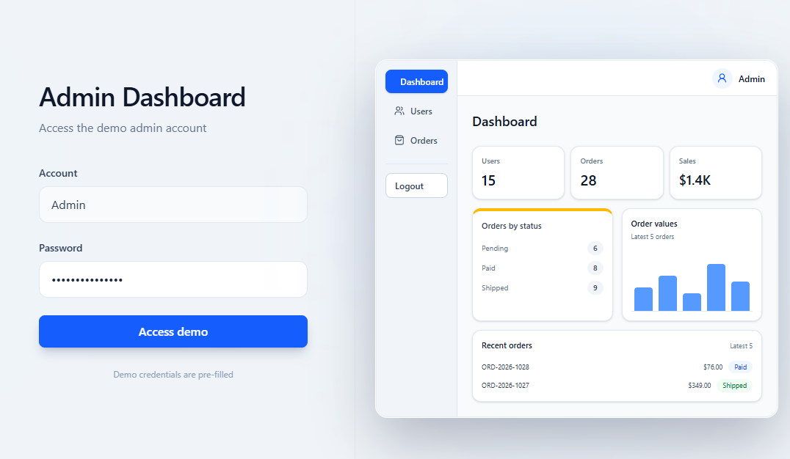

# Admin Dashboard

Admin dashboard built with Next.js, TypeScript, Prisma and PostgreSQL for managing users and orders.

**Live demo:** https://admin-dashboard-m-amroune.vercel.app

**Demo access:** Sign in with the pre-filled administrator credentials using **Access demo**.

<p align="center">
  
</p>

---

## Features

- **Dashboard:** User and order statistics, sales metrics, order status distribution and recent orders.
- **Authentication:** Auth.js credentials authentication, bcrypt password hashing, protected routes and Server Actions, and logout.
- **Users:** Creation, deletion, role management, search, filtering, sorting and server-side pagination.
- **Orders:** Creation, deletion, detail pages, status updates, search, filtering, sorting, pagination, bulk actions and status history.
- **Health Check:** API endpoint for checking the PostgreSQL database connection.

### Order Workflow

Supported status transitions:

```text
pending -> paid
pending -> cancelled
paid -> shipped
paid -> cancelled
```

`shipped` and `cancelled` are final states.

---

## Tech Stack


**Hosting:** Vercel (application) and Supabase (PostgreSQL).

---

## Testing

### Jest + React Testing Library

Unit and integration tests cover application components, pages and server-side operations.

```bash
npm test
```

### Playwright E2E

19 end-to-end tests cover authentication, protected routes, navigation, user and order management, filtering, pagination and bulk actions.

Tests run against an isolated PostgreSQL 16 database using Docker.

```bash
docker compose -f docker-compose.e2e.yml up -d
npm run test:e2e
```

GitHub Actions runs the E2E suite on pull requests and pushes to `main`.

---

## Installation

Clone the repository and install dependencies:

```bash
git clone https://github.com/m-amroune/admin-dashboard.git
cd admin-dashboard
npm install
```

Configure the required environment variables in `.env`:

```env
DATABASE_URL="your-postgresql-connection-string"
AUTH_SECRET="your-auth-secret"
```

Generate the Prisma Client and apply migrations:

```bash
npx prisma generate
npx prisma migrate deploy
```

Optionally seed the database:

```bash
npx prisma db seed
```

Start the development server:

```bash
npm run dev
```

Open http://localhost:3000.